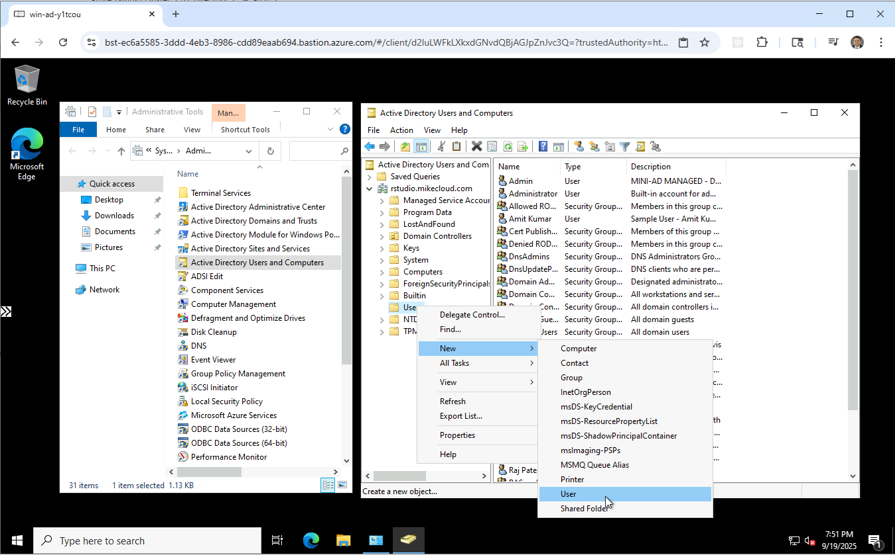
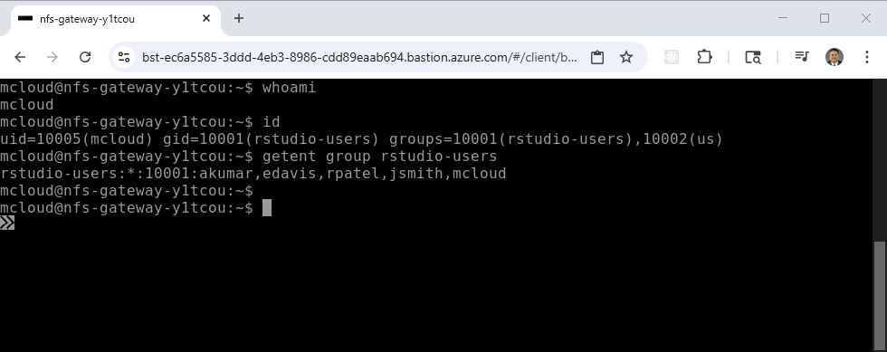

# RStudio Server Cluster on Azure: VM Scale Sets, Azure Files NFS and Active Directory

A shared **RStudio Server** cluster for small teams, built on the
[Azure Mini Active Directory](https://github.com/mamonaco1973/azure-mini-ad)
lab. An **Application Gateway** spreads users across a **VM Scale Set** of
RStudio instances built from a **Packer** image; every instance joins a
**mini-AD** domain, so users sign in with named AD accounts, and mounts a
Premium **Azure Files NFS** share for home directories and a shared R
package library. Admin-installed packages are available on every node at
once. The whole stack deploys with one script in about 45 minutes.


| Piece | Where | Role |
|---|---|---|
| **rstudio-app-gateway** | `app-gateway-subnet` | Application Gateway Standard_v2 (capacity 1) on a public IP; HTTP 80 to 8787 with cookie-based affinity; health probe `/auth-sign-in` |
| **rstudio-vmss** | `vm-subnet`, `rstudio-vmss-rg` | `Standard_D2s_v3` instances from the Packer image, default 2 (1 to 4); adds an instance when CPU is above 60%; automatic upgrade mode with a health extension |
| **rstudio_image_&lt;timestamp&gt;** | `rstudio-vmss-rg` | Packer managed image: Ubuntu 24.04 with R, RStudio Server (open source), SSSD/realmd, `aznfs` and the Azure CLI |
| **nfs&lt;suffix&gt;** | Storage, Premium FileStorage | NFS 4.1 share `nfs` (100 GiB) behind a private endpoint and the `privatelink.file.core.windows.net` zone |
| **nfs-gateway-&lt;suffix&gt;** | `vm-subnet` | Ubuntu 24.04, `Standard_B1s`, public IP; joined to AD; mounts the share and serves `/nfs` over Samba |
| **win-ad-&lt;suffix&gt;** | `vm-subnet` | Windows Server, `Standard_DS1_v2`, public IP; joined to AD; RSAT; maps the gateway's share as `Z:` |
| **mini-AD** | `mini-ad-subnet` | [`module-azure-mini-ad`](https://github.com/mamonaco1973/module-azure-mini-ad) Samba DC for `rstudio.mikecloud.com` (`RSTUDIO`) |
| **Key Vault** | `rstudio-network-rg` | admin, user and VM passwords; the VMs and scale set read them with their managed identities |
| **ad-vnet** | `10.0.0.0/23`, Central US | `vm-subnet` `10.0.0.0/25`, `mini-ad-subnet` `10.0.0.128/25`, `app-gateway-subnet` `10.0.1.128/25`; Azure Bastion only if `bastion_support` is true |

## Architecture

<picture>
  <source media="(prefers-color-scheme: dark)" srcset="architecture-dark.svg">
  
</picture>

Regenerate with `python3 make_diagram.py`. The gateway and Windows VM also
join the domain; those lines are left off the diagram to keep it readable.

- **`01-directory/`**: the resource groups, VNet, subnets and NSG, optional
  Bastion, Key Vault and its secrets, and the mini-AD DC with users and
  groups from `scripts/users.json.template`.
- **`02-servers/`**: the NFS storage account, share and private endpoint,
  the gateway and Windows VMs.
- **`03-packer/`**: the RStudio image (`rstudio_image.pkr.hcl` and its
  install scripts).
- **`04-cluster/`**: the Application Gateway, the scale set and its
  autoscale setting, and `scripts/rstudio_booter.sh`.
- **`05-rsamples/`**: sample R scripts and `packages.R`.
- **`06-utils/`**: `getNextUID` / `getNextGID` scripts for adding AD users.

## How an instance starts

`rstudio_booter.sh` mounts the share as `/nfs` and its home directory area
as `/home` with `aznfs`, reads the AD admin password from Key Vault, joins
the domain with `realm join` (SSSD with short names and the POSIX IDs from
AD), gives `linux-admins` passwordless sudo, and writes `Rprofile.site` so
the library path is the user's own library, then `/nfs/rlibs`, then the
system library. `/nfs/rlibs` belongs to `rstudio-admins`, so admins install
packages once for everyone.

## Users and groups

| User | uidNumber | Groups | Notes |
|---|---|---|---|
| jsmith | 10001 | rstudio-users, us, linux-admins, rstudio-admins, Domain Admins | sudo; writes `/nfs/rlibs` |
| edavis | 10002 | rstudio-users, us | |
| rpatel | 10003 | rstudio-users, india, linux-admins, rstudio-admins, Domain Admins | sudo; writes `/nfs/rlibs` |
| akumar | 10004 | rstudio-users, india | |

| Group | gidNumber |
|---|---|
| rstudio-users | 10001 (every user's primary group) |
| us | 10002 |
| india | 10003 |
| linux-admins | 10004 |
| rstudio-admins | 10005 |

Group names follow the NetBIOS name (`rstudio-users`, `rstudio-admins`).

## Prerequisites

* [An Azure Account](https://portal.azure.com/)
* [Install AZ CLI](https://learn.microsoft.com/en-us/cli/azure/install-azure-cli)
* [Install Terraform](https://developer.hashicorp.com/terraform/install)
* [Install Packer](https://developer.hashicorp.com/packer/install)
* [Install jq](https://jqlang.github.io/jq/download/)

`check_env.sh` expects a service principal in `ARM_CLIENT_ID`,
`ARM_CLIENT_SECRET`, `ARM_SUBSCRIPTION_ID` and `ARM_TENANT_ID`. If this is
your first time following along, we recommend starting with this video:
[Azure + Terraform: Easy Setup](https://www.youtube.com/watch?v=wwi3kVgYNOk).

## Deploy

```bash
git clone https://github.com/mamonaco1973/azure-rstudio-cluster.git
cd azure-rstudio-cluster
./apply.sh
```

`apply.sh` applies `01-directory` and `02-servers`, builds the RStudio image
with Packer, and applies `04-cluster` with the newest image. It ends by
running `validate.sh`, which waits for a healthy backend behind the gateway
and prints the endpoints:

```
============================================================================
RStudio VMSS Quick Start - Validation Output (Azure)
============================================================================

NOTE: Resource Group:        rstudio-vmss-rg
NOTE: Network Group:         rstudio-network-rg
NOTE: Key Vault:             ad-key-vault-<suffix>

NOTE: Windows RDP Host:      win-ad-<suffix>.centralus.cloudapp.azure.com
NOTE: NFS Gateway Host:      nfs-gateway-<suffix>.centralus.cloudapp.azure.com

NOTE: RStudio URL:           http://rstudio-cluster-<suffix>.centralus.cloudapp.azure.com
```

### Changing the domain name

The default domain is `rstudio.mikecloud.com`. The recommended way to override it is via the `TF_VAR_*` environment variables already stubbed out at the top of both [apply.sh](apply.sh) and [destroy.sh](destroy.sh):

```bash
export TF_VAR_dns_zone="datascience.acme.com"
export TF_VAR_realm="DATASCIENCE.ACME.COM"
export TF_VAR_netbios="DATASCIENCE"
export TF_VAR_user_base_dn="CN=Users,DC=datascience,DC=acme,DC=com"
```

Uncomment those lines before running `apply.sh`, and uncomment the matching block in `destroy.sh` before tearing down — Terraform picks them up automatically across all phases with no changes to any `variables.tf` file required.

The AD group names (e.g., `datascience-users`, `datascience-admins`) and the SSSD forced group are derived automatically from `TF_VAR_netbios` — no other changes are required.

## Try it

1. Open the **RStudio URL** and sign in as one of the users above, with the
   password from its secret in Key Vault.
2. Open a sample from `05-rsamples`; the gateway clones this repository
   into the share.
3. Add a user:
   1. RDP to the **Windows RDP Host** as `jsmith` or `rpatel` and open
      **Active Directory Users and Computers** with **View > Advanced
      Features** on.
   2. Under the domain's **Users** container, create the user with a UPN
      such as `mcloud@rstudio.mikecloud.com` and an initial password.

      

   3. Run `Z:\azure-rstudio-cluster\06-utils\getNextUID.bat` for the next
      free `uidNumber`.
   4. In **Attribute Editor**, set `uidNumber` to that value, `gidNumber` to
      `10001`, and `uid` to the login name.
   5. Under **Member Of**, add `rstudio-users` and any other groups.
   6. SSH to the **NFS Gateway Host** and check the mapping with
      `id mcloud`:

      

   7. Sign in to RStudio as the new user. They can't write `/nfs/rlibs`
      until they're in `rstudio-admins`.

## Teardown

```bash
./destroy.sh
```

## Notes

- **Lab only.** RStudio is served over plain HTTP. The VM network security
  group allows 22, 3389, 445, 8787 and 80 from anywhere, and the gateway and
  Windows VM have public IPs.
- The autoscale setting only has a scale-out rule, so the scale set grows to
  4 instances under load and doesn't shrink back on its own.
- The old README listed `india` as 10002 and `us` as 10003; the template
  sets `us` to 10002 and `india` to 10003.
